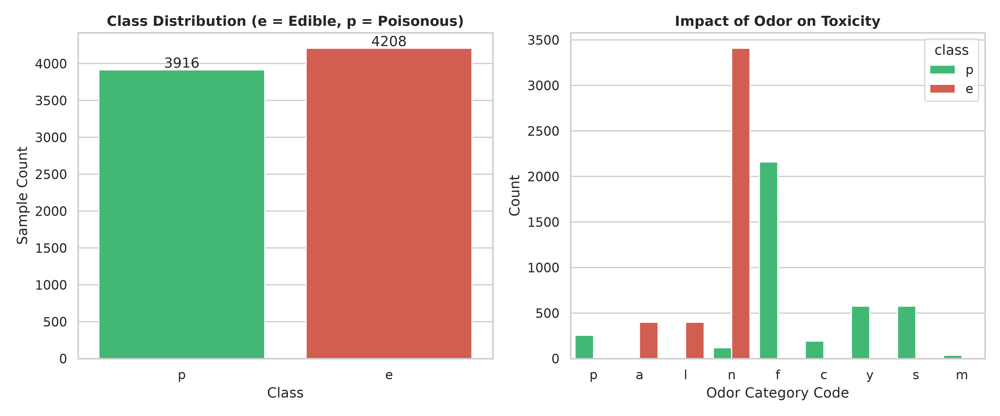
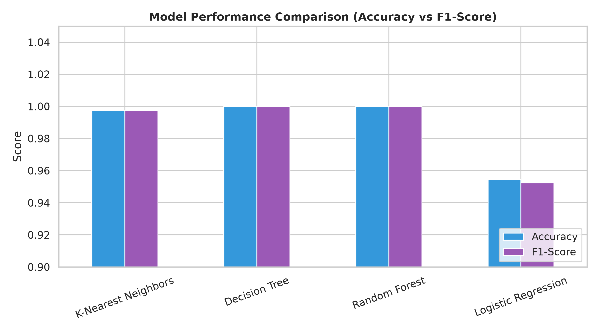
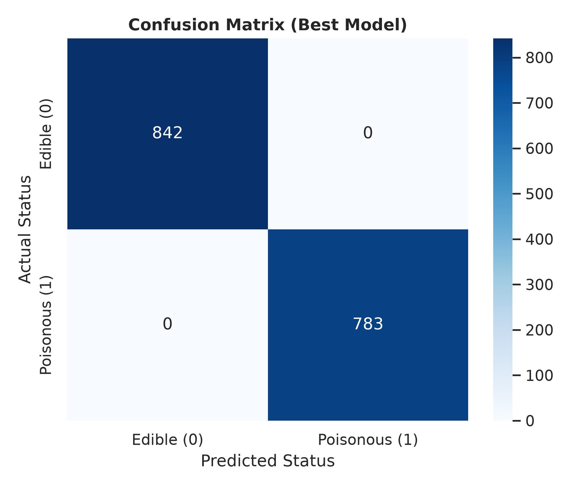

# 🍄 Mushroom Classification: Poisonous vs. Edible

[](https://www.python.org/)
[](https://scikit-learn.org/)
[](LICENSE)
[](https://github.com/)

A Machine Learning project for binary classification of mushrooms into **Edible** or **Poisonous** based on categorical physical and morphological traits. The project benchmarks multiple classification algorithms (Decision Tree, Random Forest, K-Nearest Neighbors, and Logistic Regression), eliminates data leakage, and provides actionable interpretability for real-world decision-making.

---

## 📌 Table of Contents
- [Project Overview](#-project-overview)
- [Dataset Description](#-dataset-description)
- [Key Highlights & Methodology](#-key-highlights--methodology)
- [Exploratory Data Analysis (EDA)](#-exploratory-data-analysis-eda)
- [Model Performance Benchmark](#-model-performance-benchmark)
- [Project Structure](#-project-structure)
- [Installation & Quickstart](#-installation--quickstart)
- [Reproducibility](#-reproducibility)
- [Conclusions & Practical Insights](#-conclusions--practical-insights)
- [License](#-license)

---

## 📖 Project Overview

Wild mushroom foraging carries extreme health hazards due to the difficulty of differentiating edible species from lethal look-alikes. This repository implements an end-to-end Machine Learning pipeline to classify mushrooms with maximum safety and zero false negatives on toxic specimens.

* **Target Variable:** `class` (0 = Edible `e`, 1 = Poisonous `p`)
* **Objective:** Compare 4 standard classification models and select the safest, most interpretable model for practical verification.
* **Selected Model:** **Decision Tree Classifier** (100% Accuracy & F1-Score, with rule-based human interpretability).

---

## 📊 Dataset Description

The dataset is sourced from the renowned **UCI Machine Learning Repository (Mushroom Dataset)**:
- **Total Samples:** 8,124 instances (4,208 Edible, 3,916 Poisonous)
- **Features:** 22 categorical attributes describing cap shape, cap surface, cap color, bruises, odor, gill attachment, gill spacing, gill size, stalk root, ring type, spore print color, habitat, etc.
- **Data Hygiene:** 
  - The feature `veil-type` was removed prior to modeling because all records contain a single constant value (`'p'`), providing zero variance.

---

## ⚙️ Key Highlights & Methodology

1. **Strict Prevention of Data Leakage:**
   - The dataset is split into **Train (80%)** and **Test (20%)** sets *prior* to label encoding (`LabelEncoder`).
   - Encoders are fitted solely on the training partition and applied to the test partition, preventing test-set knowledge leakage.
2. **Stratified Partitioning:**
   - Preserves balanced target class proportions (`stratify=y`) across both train and test splits.
3. **Comprehensive Model Comparison:**
   - Evaluates linear, distance-based, and tree-based paradigms.

---

## 🔍 Exploratory Data Analysis (EDA)



### Observations:
- **Target Balance:** The dataset is well-balanced (~51.8% edible vs ~48.2% poisonous), requiring no synthetic oversampling or undersampling.
- **Odor as a Strong Indicator:** Odor is one of the most decisive features in identifying toxicity. Certain odors (e.g., foul, pungent, fishy) correspond exclusively to poisonous mushrooms, while almond and anise scents correlate strongly with edible varieties.

---

## 📈 Model Performance Benchmark

All models were evaluated on the 20% unseen test split (1,625 samples):

| Model | Accuracy | F1-Score | Precision | Recall | Notes |
|---|---|---|---|---|---|
| **Decision Tree** 🏆 | **1.0000 (100%)** | **1.0000 (100%)** | **1.0000** | **1.0000** | **Best for interpretability & zero false negatives** |
| **Random Forest** | **1.0000 (100%)** | **1.0000 (100%)** | **1.0000** | **1.0000** | Ensemble stability with perfect separation |
| **K-Nearest Neighbors (KNN)** | 0.9975 (99.75%) | 0.9975 (99.75%) | 0.9975 | 0.9975 | High boundary fidelity in categorical space |
| **Logistic Regression** | 0.9545 (95.45%) | 0.9524 (95.24%) | 0.9580 | 0.9470 | Baseline linear boundary model |

<p align="center">
  
  
</p>

---

## 📁 Project Structure

```text
mushroom-classification-ml/
├── data/
│   └── mushrooms.csv             # Dataset (UCI Mushroom Data)
├── figures/
│   ├── eda_distribution.png      # Exploratory Data Analysis plots
│   ├── model_comparison.png     # Benchmark bar chart across models
│   └── confusion_matrix.png     # Confusion matrix of best model
├── notebooks/
│   └── mushroom_classification.ipynb  # Interactive Jupyter notebook
├── src/
│   └── train.py                  # Standalone training and evaluation script
├── .gitignore                    # Python and OS ignore patterns
├── LICENSE                       # MIT License
├── README.md                     # Project documentation (English)
└── requirements.txt              # Production and development dependencies
```

---

## 🚀 Installation & Quickstart

### 1. Clone the Repository
```bash
git clone https://github.com/<your-username>/mushroom-classification-ml.git
cd mushroom-classification-ml
```

### 2. Set Up a Virtual Environment
```bash
# Using standard venv
python3 -m venv venv
source venv/bin/activate  # On Windows: venv\Scripts\activate
```

### 3. Install Dependencies
```bash
pip install -r requirements.txt
```

### 4. Run the Pipeline
Train models and regenerate figures:
```bash
python3 src/train.py
```

Or open the interactive Jupyter Notebook:
```bash
jupyter notebook notebooks/mushroom_classification.ipynb
```

---

## 🔬 Reproducibility

All stochastic models are initialized with a fixed random seed (`random_state=42`) across train/test splits, decision tree splitting, and random forest bagging to guarantee identical metric reproduction on any machine.

---

## 💡 Conclusions & Practical Insights

1. **Safety First:** In poisonous mushroom detection, a **False Negative** (classifying a toxic mushroom as edible) can be fatal. The Decision Tree achieved a False Negative rate of **0%** on the test set.
2. **Model Transparency:** Even though Random Forest also achieves 100% accuracy, the **Decision Tree** is preferred because its decision nodes (e.g., *if odor == foul, then poisonous*) can be audited by mycologists and translated into human-readable safety checklists.
3. **Real-world Deployment:** This model can serve as the core engine for mobile applications assisting foragers. However, it should always be used as a **secondary advisory tool**, accompanied by physical expert verification.

---

## 📄 License

This project is licensed under the [MIT License](LICENSE).
